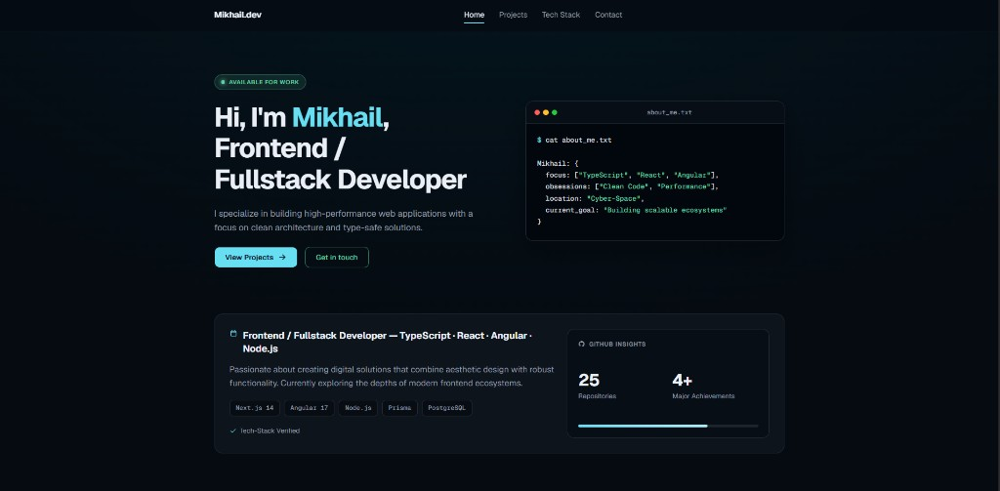

# Mikhail.dev — Portfolio

Personal portfolio of **Mikhail** (chebupell) — Frontend / Fullstack developer focused on TypeScript, React, Angular, and Node.js.

**Live site:** [https://mikhailportfol.netlify.app/](https://mikhailportfol.netlify.app/)



## Stack

This site is built with **Angular 22**, standalone components, SSR, Tailwind CSS, and Spartan NG UI.

Featured projects on the site include **SkillsZen** (React 19) and **Finance Dashboard** (Angular 21).

## Local development

```bash
npm install
npm start
```

Open [http://localhost:4200/](http://localhost:4200/).

```bash
npm run build
```

Production build output goes to `dist/`.
